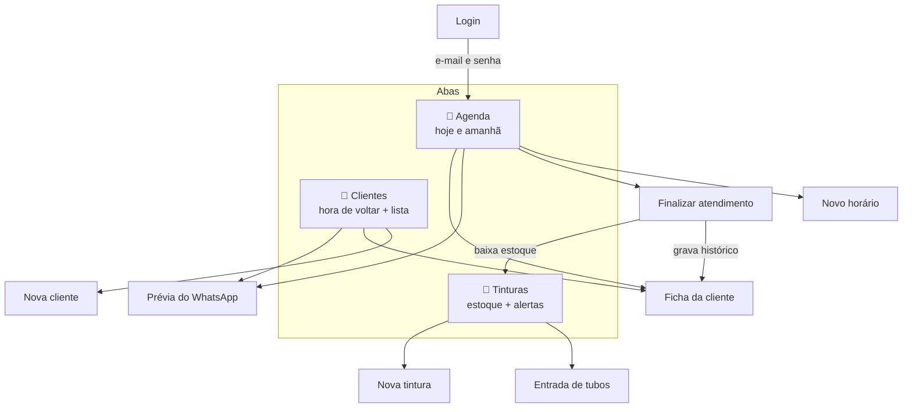
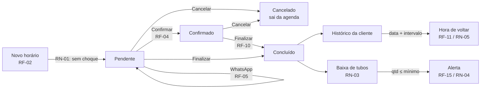

# Modelagem, mockup e validação — Lucy Cabeleireira

**Etapa 03 — Modelagem, mockup e validação**
**Responsável:** Andreza Pinho Lobo Martins · **Data:** 23/11/2026 · **Versão:** 0.1
**Base:** Especificação de Requisitos v0.1 (nenhuma função nova foi adicionada)

---

## 1. Mapa de navegação

O sistema tem **3 abas fixas** na parte de baixo da tela, pensadas para o polegar no celular (RNF-01).

> No GitHub, este diagrama aparece desenhado automaticamente. No VS Code, instale a extensão _Markdown Preview Mermaid Support_ para ver.

## 2. Fluxo principal: do agendamento ao estoque

É a cadeia que o Prof. Bruno avalia (problema → requisito → tela → código → teste).

## 3. Telas do mockup × requisitos

| Tela                  | O que mostra                                                                                       | Requisitos                         |
| --------------------- | -------------------------------------------------------------------------------------------------- | ---------------------------------- |
| Login                 | E-mail, senha, mensagem de erro                                                                    | RF-01, RNF-04                      |
| Agenda                | Hoje e amanhã, status, alergia visível, botões WhatsApp / Confirmar / Finalizar / Ficha / Cancelar | RF-03, RF-04, RF-05, RN-02, RNF-02 |
| Novo horário          | Cliente, data, hora, duração, serviços; aviso de choque de horário                                 | RF-02, RN-01                       |
| Finalizar atendimento | Alergia em destaque, tubos usados por tintura, aviso de estoque insuficiente                       | RF-10, RN-03, RN-04                |
| Clientes              | Lista "Hora de voltar" com lembrete pelo WhatsApp; busca; lista geral                              | RF-08, RF-11, RN-05                |
| Ficha                 | **Alergia no topo**, consentimento LGPD, anotações, histórico, excluir                             | RF-07, RF-09, RNF-06               |
| Nova cliente          | Nome e telefone obrigatórios; alergia só com consentimento                                         | RF-07, RN-07, RNF-06               |
| Tinturas              | Aviso de estoque baixo, quantidade de tubos, entrada de tubos, nova tintura                        | RF-13, RF-14, RF-15                |

**Estados previstos:** lista vazia ("Nenhum horário"), erro de formulário, confirmação antes de cancelar ou excluir, mensagem de sucesso (aviso no topo).

**Acessibilidade aplicada:** botões com pelo menos 44 px, contraste alto, foco visível com o teclado, alergia anunciada como alerta para leitores de tela, tecla Esc fecha janelas.

## 4. O que o mockup **não** é

- Os dados são **fictícios** e **nada é salvo**: ao recarregar a página, tudo volta ao início.
- O botão de WhatsApp mostra só a **prévia** da mensagem.
- O login aceita qualquer e-mail e senha.

O sistema de verdade (com banco de dados) será feito na Etapa 05.

---

## 5. Roteiro do teste com a Lucy

**Como fazer:** abra o mockup no celular, entregue para a Lucy e leia **uma tarefa por vez**. **Não ajude e não aponte onde clicar.** Só observe e anote. Se ela travar por mais de 1 minuto, marque "não conseguiu" e passe para a próxima.

| #   | Tarefa (leia em voz alta)                                                                         | Testa         | Conseguiu sozinha?      | Tempo | Onde hesitou / o que disse |
| --- | ------------------------------------------------------------------------------------------------- | ------------- | ----------------------- | ----- | -------------------------- |
| T1  | "Entre no sistema."                                                                               | RF-01         | ☐ Sim ☐ Com ajuda ☐ Não |       |                            |
| T2  | "A Ana vem hoje às 14h. Confirme o horário dela."                                                 | RF-04, RNF-02 | ☐ Sim ☐ Com ajuda ☐ Não |       |                            |
| T3  | "Mande a mensagem de confirmação para a Joana."                                                   | RF-05         | ☐ Sim ☐ Com ajuda ☐ Não |       |                            |
| T4  | "A Carla ligou e quer marcar um corte hoje às 14h30. Marque." _(deve aparecer o aviso de choque)_ | RF-02, RN-01  | ☐ Sim ☐ Com ajuda ☐ Não |       |                            |
| T5  | "A Maria terminou a tintura e usou 1 tubo de 7.0. Finalize o atendimento."                        | RF-10         | ☐ Sim ☐ Com ajuda ☐ Não |       |                            |
| T6  | "Quantos tubos de 7.0 sobraram?"                                                                  | RF-13         | ☐ Sim ☐ Com ajuda ☐ Não |       |                            |
| T7  | "Qual é a alergia da Carla?"                                                                      | RF-09         | ☐ Sim ☐ Com ajuda ☐ Não |       |                            |
| T8  | "Quais clientes você deveria chamar para voltar?"                                                 | RF-11         | ☐ Sim ☐ Com ajuda ☐ Não |       |                            |
| T9  | "Você comprou 3 tubos de 8.1. Registre."                                                          | RF-14         | ☐ Sim ☐ Com ajuda ☐ Não |       |                            |

### Perguntas depois do teste

1. O que foi mais fácil? E o mais difícil?
2. Faltou alguma coisa que você usaria todo dia?
3. Tem alguma coisa aqui que você **não** usaria?
4. O texto da mensagem de confirmação está bom? Mudaria alguma palavra?
5. Você usaria isso no celular entre uma cliente e outra?

### Resultado

- **Tarefas concluídas sozinha:** \_\_\_ de 9
- **Principais problemas encontrados:**
  1.
  2.
- **O que vou mudar no mockup:**
  1.
  2.
- **Frase marcante da Lucy (para o slide 8):** "..."

> **Evidência para os slides 8 e 9:** tire um print da tela antes e depois de cada ajuste e guarde nesta pasta.
